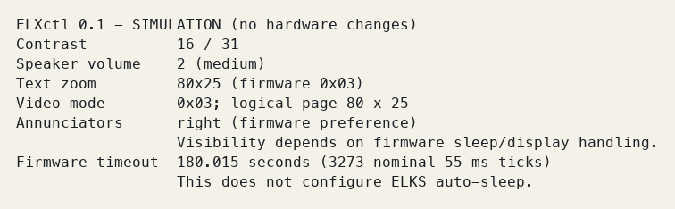

> ⚠️ I’m developing this project with AI assistance out of personal interest. It may not fully align with the ELKS maintainer team’s architectural or development guidelines. Please use it at your own discretion. ⚠️

# ELX tool suite for the HP 200LX

Small native utilities for the HP 200LX running
[ELKS Linux on HP 200LX](https://github.com/l00nix/elks-on-hp200lx). Battery
monitoring, firmware/system status and interactive hardware controls without Nano-X.

**Package 0.2.1 contains four HP-specific tools:** ELXstat, ELXbat, ELXctl and
ELXdash. This update brings ELXbat 0.1.4 and ELXdash 0.2.0-test4 from the HP
200LX 4.0 source bundle into the standalone suite. It restores incremental gauge
redraws and the Battery menu. Experimental charging starts remain locked unless
`--charge-test` is explicitly supplied. See [testing status](docs/TESTING.md).

[ELKS-Cmdr](https://github.com/l00nix/ELKS-cmdr) (`cmdr`) and
[ELKS-scrcap](https://github.com/l00nix/ELKS-scrcap) (`scrcap`) are separate projects.
Their source and executables are no longer bundled in this suite. Historical
six-tool releases remain in the release history.

[Download releases](https://github.com/l00nix/HP-200LX-elx-suite/releases) ·
[Tool guides](docs/tools) · [Build from source](docs/BUILDING.md) ·
[Testing status](docs/TESTING.md)

## The toolbox

| Tool | Version | System | Purpose |
| --- | --- | --- | --- |
| [ELXstat](docs/tools/elxstat.md) | 0.1 | ELKS | Read-only firmware and system status |
| [ELXbat](docs/tools/elxbat.md) | 0.1.4 | ELKS | Large battery-voltage gauges and warning markers |
| [ELXctl](docs/tools/elxctl.md) | 0.1 | ELKS | Command-line hardware controls |
| [ELXdash](docs/tools/elxdash.md) | 0.2.0-test4 | ELKS | Battery gauges and interactive controls |

## Install with EPT

Package **0.2.1 is available from [8088retro EPT](http://ept.8088retro.com)**.
The [upstream recipe PR](https://github.com/sammothxc/ept/pull/13) has been
submitted and awaits review; installation from 8088retro is available now.

On an HP 200LX with ELKS networking and EPT working, edit `/etc/ept.cfg` and
add the following line **without removing your existing repository lines**:

```text
REPO=http://ept.8088retro.com
```

Then install only this package:

```sh
ept update
ept install elxtools
elxstat --version
elxbat --version
elxctl --version
elxdash --version
```

The `elxtools` package installs `/bin/elxstat`, `/bin/elxbat`, `/bin/elxctl`,
`/bin/elxdash` and license/usage files under `/lib/elxtools`. All installed names
fit DOS/FAT 8.3. It does not install Cmdr, scrcap, DOS LXdash, a kernel, startup
scripts or automatic charging settings. `ept remove elxtools` removes the package's files.
If you already copied these executables manually, preserve those copies before
installing: EPT owns and replaces the same `/bin` paths.

These tools need supported HP firmware, readable `/dev/kmem` (normally root),
and an HP firmware-aware ELKS kernel. Start graphics tools from the local HP
text console. This package is **not for generic ELKS PCs or the Amstrad PPC**.
The upstream recipe submission and 8088retro package publication are tracked in
[EPT integration](integration/README.md).

## Manual download

[Releases](https://github.com/l00nix/HP-200LX-elx-suite/releases) provide the
four-tool `elxtools-0.2.1-elks.zip`, checksums and build/audit evidence.
Copy `bin/` and `lib/` into the matching ELKS directories using a binary-safe
transfer method, preserving executable permissions. Historical 0.1.x ZIPs contain
six tools and are not the current package. The package version does not replace
individual tool versions. Version 0.2.0 used older application snapshots; use
0.2.1 for the newer dashboard and battery display.

## ELXdash — how to use

```sh
./elxdash
./elxdash --demo
```


*ELXdash 0.1.1: actual renderer in demo mode, synthetic readings.*

Use  to select, then
 /  or
 /  to adjust.
 rereads;  or
 exits.

Press **B** to open the Battery menu; Up/Down/Tab select a row, Left/Right
adjust a limit, Enter selects and Esc closes. Without `--charge-test`, selecting
Start reports **Start locked**. The optional NiCd test supervisor is experimental,
not a validated full-charge controller. [Scope and controls](docs/tools/elxdash.md#experimental-battery-menu).

Contrast and volume gauges reflect read-back values. Text zoom is queued until
exit; annunciator preference and BIOS timeout also have selectable controls.
**BIOS timeout is not ELKS auto-sleep.** Battery gauges are read-only volts, not
charge percentages. [ELXdash guide](docs/tools/elxdash.md)

## ELXbat — how to use

```sh
./elxbat
./elxbat --text --watch
```


*ELXbat 0.1.3: actual renderer using an offline fixture. Not a hardware capture.*

Outlined triangles show nominal low thresholds; the solid triangle shows main
critical. Actual firmware warning flags remain separate because of hysteresis.
 rereads;  /
 exits. [Usage and thresholds](docs/tools/elxbat.md)

Both graphical tools check the firmware power-status byte once per second.
The plug and cable indicate external power; a bolt appears only for **active
charging**. Battery power has a battery symbol; a failed read shows `?` and an
unknown/stale message. Only the status strip redraws when this reading changes.
Gauge values are polled at their normal interval; only changed gauge regions
are redrawn. Unchanged polls leave the display and open menu steady. Firmware update latency still needs
plug/unplug testing on the HP; polling does not force a fresh measurement.


*Actual renderer with synthetic states: battery, external, charging enabled but
inactive, active charging, fast charging, unplugged, and read failure.*

## ELXstat — how to use

```sh
./elxstat
./elxstat -v
./elxstat display
```


*Actual offline-fixture output, rendered as a terminal image.*

Read battery, power, display, serial or system sections without changing
settings. Cached fields are not guaranteed live ELKS policy. [Usage guide](docs/tools/elxstat.md)

## ELXctl — how to use

```sh
./elxctl status
./elxctl contrast 16
./elxctl volume 2
./elxctl --dry-run zoom 40x16
```



*Actual simulation output, rendered as a terminal image.*

Controls contrast, volume, text zoom, annunciator preference and firmware
timeout. Omit a value to query; each applied change is read back.
[All options](docs/tools/elxctl.md)

## Documentation and source

- [Build instructions](docs/BUILDING.md), [test status](docs/TESTING.md), [contributing](CONTRIBUTING.md).
- [Preview provenance](docs/assets/previews/README.md): interim images to replace after hardware testing.
- `tools/elx-utils`: ELXstat, ELXbat and shared battery/graphics code.
- `tools/elx-ctl`: command planning and hardware controls.
- `tools/elx-dash`: ELXdash interface and ELKS/host platform backends.
## Credits and inspiration

The HP palmtop community's DOS utilities inspired these independent ELKS tools:

| ELX tool | Inspiration |
| --- | --- |
| ELXstat | LXSTAT's hardware and firmware status reports |
| ELXbat | BATG's main and backup battery-voltage display |
| ELXctl / ELXdash | CXCTL (Control 1000CX) hardware controls; BATG battery monitoring; ABC/LX charging workflow |

[@l00nix](https://github.com/l00nix)'s HP 200LX book and supplied screenshots/output provided reference
material. The half-circle gauges follow his requested design direction.
The HP 100LX/200LX Developer's Guide documents the firmware interfaces; the
ELKS project supplies the operating system and toolchain. ELKSWeb contributed
reused graphics/console techniques, build helpers and the font used here.

The DOS tools are behavioural and visual references; their original code and
executables are not bundled. Reused code and font notices remain with the source
and in the licences below. See each tool's source README for detailed attribution.

## License

Project code: [GPL-2.0-or-later](LICENSE). The reused font has its own
[license](docs/FONT-LICENSE).
No HP ROM dump, DOS system files, original BATG/CXCTL/GEMCAP code or credentials
are included.
