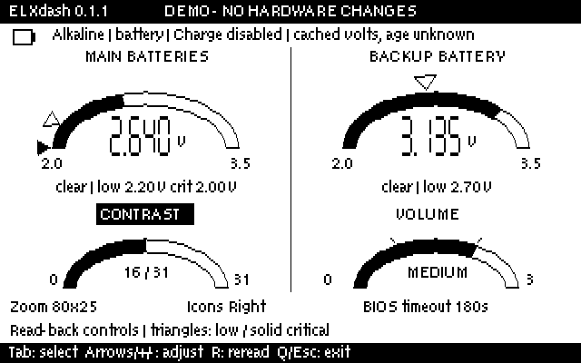
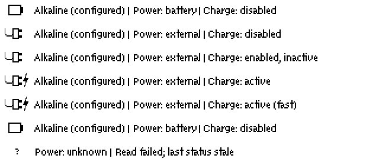
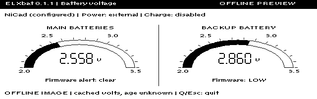

> ⚠️ I’m developing this project with AI assistance out of personal interest. It may not fully align with the ELKS maintainer team’s architectural or development guidelines. Please use it at your own discretion. ⚠️

# ELX tool suite for the HP 200LX

Small native utilities for the HP 200LX running
[ELKS Linux on HP 200LX](https://github.com/l00nix/elks-on-hp200lx). Battery
monitoring, hardware controls, screenshots and a classic two-panel file manager
without Nano-X.

**Historical suite prerelease:** these bundled builds have automated/emulator checks but still
need physical HP validation. The original ELXstat/ELXbat 0.1 were observed running
on the palmtop; that does not validate the newer builds. Every image below is
labelled with its software-preview origin.

**Standalone tools:** [Cmdr](https://github.com/l00nix/cmdr) (`cmdr`) and
[scrcap](https://github.com/l00nix/ELKS-scrcap) (`scrcap`) now have their own repositories,
8.3-compatible installed names, ELKS external-build entry points and EPT recipes.
The four HP firmware tools remain here. Existing suite releases and the source
snapshots below retain their original names; new development of the file manager
and capture utility happens in the standalone repositories. Upstream build and
EPT server inclusion remain subject to maintainer acceptance:
[ELKS PR #2858](https://github.com/ghaerr/elks/pull/2858) and
[EPT PR #12](https://github.com/sammothxc/ept/pull/12).

[Download releases](https://github.com/l00nix/HP-200LX-elx-suite/releases) ·
[Tool guides](docs/tools) · [Build from source](docs/BUILDING.md) ·
[Testing status](docs/TESTING.md)

## The toolbox

| Tool | Version | System | Purpose |
| --- | --- | --- | --- |
| [ELXstat](docs/tools/elxstat.md) | 0.1 | ELKS | Read-only firmware and system status |
| [ELXbat](docs/tools/elxbat.md) | 0.1.3 | ELKS | Large battery-voltage gauges and warning markers |
| [ELXctl](docs/tools/elxctl.md) | 0.1 | ELKS | Command-line hardware controls |
| [ELXdash](docs/tools/elxdash.md) | 0.1.1 | ELKS | Battery gauges and interactive controls |
| [Cmdr](https://github.com/l00nix/cmdr) | 0.2.0 | ELKS / ANSI terminal | Standalone two-panel file manager (`cmdr`); formerly ELX Commander |
| [ELKS-scrcap](https://github.com/l00nix/ELKS-scrcap) | 0.5.0 | ELKS / PC text, CGA, EGA/VGA, HP | Standalone monochrome BMP/PBM capture up to 640×480 (`scrcap`); formerly ELXcap |

## Get the binaries

The **Releases** section contains `ELX-Suite-0.1.1-binaries.zip` with the historical
six ELKS binaries, plus individual tool/dashboard packages with source and build
evidence. `SHA256SUMS` checks release assets; `BINARY-MANIFEST.json` identifies
each executable. The suite version does not replace the individual tool versions.

For ELKS, copy the required files from `ELKS/` using your normal binary-safe
transfer method, then `chmod 755` them. Start graphics tools from the local HP
text console. Firmware tools need readable `/dev/kmem`, normally as root, and
a firmware-aware HP 200LX ELKS kernel. Commander also works over serial.

No installer modifies a kernel, CF
image or startup configuration. ELXcap's optional hotkey needs a separate kernel
integration; ordinary and delayed captures do not.

## ELXdash — how to use

```sh
./elxdash
./elxdash --demo
```



*ELXdash 0.1.1: actual renderer in demo mode, synthetic readings.*

Use  to select, then
 /  or
 /  to adjust.
 rereads;  or
 exits.

Contrast and volume gauges reflect read-back values. Text zoom is queued until
exit; annunciator preference and BIOS timeout also have selectable controls.
**BIOS timeout is not ELKS auto-sleep.** Battery gauges are read-only volts, not
charge percentages. [ELXdash guide](docs/tools/elxdash.md)

## ELXbat — how to use

```sh
./elxbat
./elxbat --text --watch
```


*ELXbat 0.1.3: actual renderer using an offline fixture. Not a hardware capture.*

Outlined triangles show nominal low thresholds; the solid triangle shows main
critical. Actual firmware warning flags remain separate because of hysteresis.
 rereads;  /
 exits. [Usage and thresholds](docs/tools/elxbat.md)

Both graphical tools check the firmware power-status byte once per second.
The plug and cable indicate external power; a bolt appears only for **active
charging**. Battery power has a battery symbol; a failed read shows `?` and an
unknown/stale message. Only the status strip redraws when this reading changes.
Gauges retain their normal refresh interval. Firmware update latency still needs
plug/unplug testing on the HP; polling does not force a fresh measurement.



*Actual renderer with synthetic states: battery, external, charging enabled but
inactive, active charging, fast charging, unplugged, and read failure.*

## ELXstat — how to use

```sh
./elxstat
./elxstat -v
./elxstat display
```


*Actual offline-fixture output, rendered as a terminal image.*

Read battery, power, display, serial or system sections without changing
settings. Cached fields are not guaranteed live ELKS policy. [Usage guide](docs/tools/elxstat.md)

## ELXctl — how to use

```sh
./elxctl status
./elxctl contrast 16
./elxctl volume 2
./elxctl --dry-run zoom 40x16
```


*Actual simulation output, rendered as a terminal image.*

Controls contrast, volume, text zoom, annunciator preference and firmware
timeout. Omit a value to query; each applied change is read back.
[All options](docs/tools/elxctl.md)

## Cmdr — how to use

```sh
cmdr /root /tmp
```


*Native ELKS binary under elksemu, with sample directories; rendered terminal output.*

 switches panels;
 views;  copies;
 moves;  quits.
File operations require confirmation and refuse existing destinations.
[Current key reference and limits](https://github.com/l00nix/cmdr#use) ·
[Legacy suite guide](docs/tools/elxcommander.md)

## scrcap — how to use

From an existing serial shell, capture the screen currently on the HP:

```sh
scrcap /root/SCREEN.BMP
scrcap -f pbm /root/SCREEN.PBM
```



*ELXcap BMP from an offline ELXbat framebuffer, losslessly converted to PNG for viewing.*

The examples above use the standalone scrcap executable. Version 0.5 adds generic
PC text and EGA/VGA graphics, with variable monochrome output up to 640×480.
HP 80×25 text and CGA capture remain supported. PPC text capture has been tested;
physical EGA/VGA validation remains pending, and original EGA requires a known
register profile. [Usage and display limits](https://github.com/l00nix/ELKS-scrcap#use).

Delayed capture works without kernel changes. The optional
 hotkey
requires a separately integrated, compatible HP kernel patch; it is not part of
the ordinary standalone installation. [Capture instructions](docs/tools/elxcap.md)

## Documentation and source

- [Build instructions](docs/BUILDING.md), [test status](docs/TESTING.md), [contributing](CONTRIBUTING.md).
- [Preview provenance](docs/assets/previews/README.md): interim images to replace after hardware testing.
- `tools/elx-utils`: ELXstat, ELXbat and shared battery/graphics code.
- `tools/elx-ctl`: command planning and hardware controls.
- `tools/elx-dash`: ELXdash interface and ELKS/host platform backends.
- `tools/elx-commander`, `tools/elx-cap`: frozen legacy source snapshots. Maintained
  versions are [Cmdr](https://github.com/l00nix/cmdr) and
  [scrcap](https://github.com/l00nix/ELKS-scrcap).

## Credits and inspiration

The HP palmtop community's DOS utilities inspired these independent ELKS tools:

| ELX tool | Inspiration |
| --- | --- |
| ELXstat | LXSTAT's hardware and firmware status reports |
| ELXbat | BATG's main and backup battery-voltage display |
| ELXctl / ELXdash | CXCTL (Control 1000CX) hardware controls; BATG battery monitoring |
| ELXcap | GEMCAP's hotkey-to-file screen-capture workflow |
| ELX Commander | Norton Commander and classic two-panel file managers |

Alexander Rau's HP 200LX book and supplied screenshots/output provided reference
material. The half-circle gauges follow his requested design direction.
The HP 100LX/200LX Developer's Guide documents the firmware interfaces; the
ELKS project supplies the operating system and toolchain. ELKSWeb contributed
reused graphics/console techniques, build helpers and the font used here.

The DOS tools are behavioural and visual references; their original code and
executables are not bundled. Reused code and font notices remain with the source
and in the licences below. See each tool's source README for detailed attribution.

## License

Project code: [GPL-2.0-or-later](LICENSE). The reused font has its own
[license](docs/FONT-LICENSE).
No HP ROM dump, DOS system files, original BATG/CXCTL/GEMCAP code or credentials
are included.
