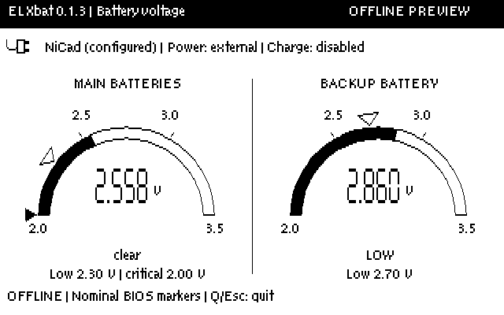
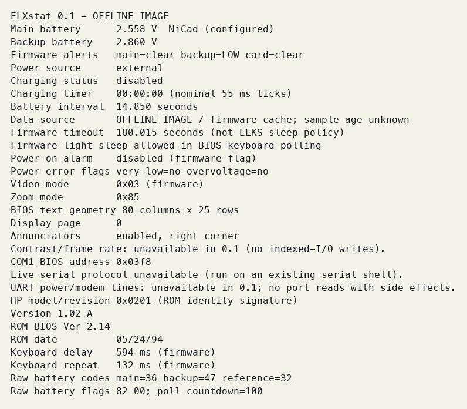
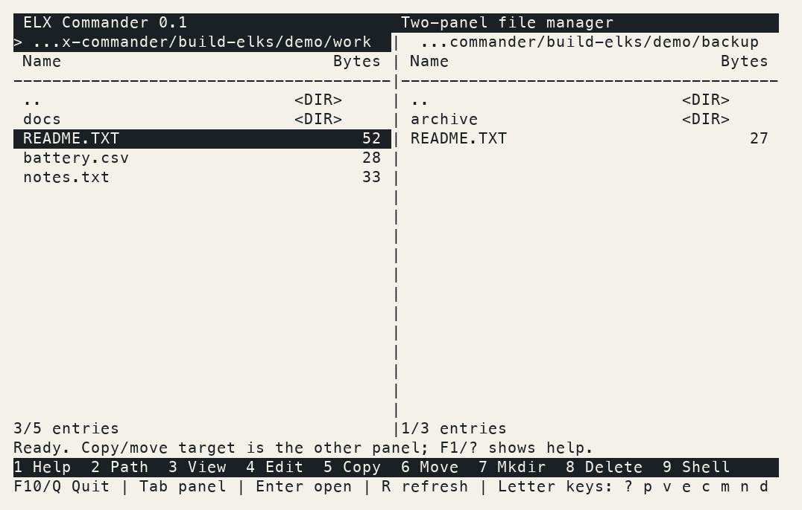

# ELX tool suite for the HP 200LX

Small native utilities for the HP 200LX running
[ELKS Linux on HP 200LX](https://github.com/l00nix/elks-on-hp200lx). Battery
monitoring, hardware controls, screenshots and a classic two-panel file manager
without Nano-X.

**Initial prerelease:** current builds have automated/emulator checks but still
need physical HP validation. The original ELXstat/ELXbat 0.1 were observed running
on the palmtop; that does not validate the newer builds. Every image below is
labelled with its software-preview origin.

[Download releases](https://github.com/l00nix/HP-200LX-elx-suite/releases) ·
[Tool guides](docs/tools) · [Build from source](docs/BUILDING.md) ·
[Testing status](docs/TESTING.md)

## The toolbox

| Tool | Version | System | Purpose |
| --- | --- | --- | --- |
| [ELXstat](docs/tools/elxstat.md) | 0.1 | ELKS | Read-only firmware and system status |
| [ELXbat](docs/tools/elxbat.md) | 0.1.2 | ELKS | Large battery-voltage gauges and warning markers |
| [ELXctl](docs/tools/elxctl.md) | 0.1 | ELKS | Command-line hardware controls |
| [ELXdash](docs/tools/elxdash.md) | 0.1 | ELKS | Battery gauges and interactive controls |
| [ELX Commander](docs/tools/elxcommander.md) | 0.1 | ELKS | Two-panel text file manager (`elxcmd`) |
| [ELXcap](docs/tools/elxcap.md) | 0.1 | ELKS | Lossless BMP/PBM screen captures |

## Get the binaries

The **Releases** section contains `ELX-Suite-0.1.0-binaries.zip` with the current
six ELKS binaries, plus individual tool/dashboard packages with source and build
evidence. `SHA256SUMS` checks release assets; `BINARY-MANIFEST.json` identifies
each executable. The suite version does not replace the individual tool versions.

For ELKS, copy the required files from `ELKS/` using your normal binary-safe
transfer method, then `chmod 755` them. Start graphics tools from the local HP
text console. Firmware tools need readable `/dev/kmem`, normally as root, and
a firmware-aware HP 200LX ELKS kernel. Commander also works over serial.

No installer modifies a kernel, CF
image or startup configuration. ELXcap's optional hotkey needs a separate kernel
integration; ordinary and delayed captures do not.

## ELXdash — how to use

```sh
./elxdash
./elxdash --demo
```


*ELXdash 0.1: actual renderer in demo mode, synthetic readings.*

Use  to select, then
 /  or
 /  to adjust.
 rereads;  or
 exits.

Contrast and volume gauges reflect read-back values. Text zoom is queued until
exit; annunciator preference and BIOS timeout also have selectable controls.
**BIOS timeout is not ELKS auto-sleep.** Battery gauges are read-only volts, not
charge percentages. [ELXdash guide](docs/tools/elxdash.md)

## ELXbat — how to use

```sh
./elxbat
./elxbat --text --watch
```



*ELXbat 0.1.2: actual renderer using an offline fixture. Not a hardware capture.*

Outlined triangles show nominal low thresholds; the solid triangle shows main
critical. Actual firmware warning flags remain separate because of hysteresis.
 rereads;  /
 exits. [Usage and thresholds](docs/tools/elxbat.md)

## ELXstat — how to use

```sh
./elxstat
./elxstat -v
./elxstat display
```



*Actual offline-fixture output, rendered as a terminal image.*

Read battery, power, display, serial or system sections without changing
settings. Cached fields are not guaranteed live ELKS policy. [Usage guide](docs/tools/elxstat.md)

## ELXctl — how to use

```sh
./elxctl status
./elxctl contrast 16
./elxctl volume 2
./elxctl --dry-run zoom 40x16
```


*Actual simulation output, rendered as a terminal image.*

Controls contrast, volume, text zoom, annunciator preference and firmware
timeout. Omit a value to query; each applied change is read back.
[All options](docs/tools/elxctl.md)

## ELX Commander — how to use

```sh
./elxcmd /root /tmp
```



*Native ELKS binary under elksemu, with sample directories; rendered terminal output.*

 switches panels;
 views;  copies;
 moves;  quits.
File operations require confirmation and refuse existing destinations.
[Complete key reference and limits](docs/tools/elxcommander.md)

## ELXcap — how to use

From an existing serial shell, capture the screen currently on the HP:

```sh
./elxcap /root/SCREEN.BMP
./elxcap -f pbm /root/SCREEN.PBM
```


*ELXcap BMP from an offline ELXbat framebuffer, losslessly converted to PNG for viewing.*

Delayed capture works without kernel changes. The optional
 hotkey
requires the included kernel integration and is **not available on an unchanged
3.8 beta1 kernel**. [Capture instructions](docs/tools/elxcap.md)

## Documentation and source

- [Build instructions](docs/BUILDING.md), [test status](docs/TESTING.md), [contributing](CONTRIBUTING.md).
- [Preview provenance](docs/assets/previews/README.md): interim images to replace after hardware testing.
- `tools/elx-utils`: ELXstat, ELXbat and shared battery/graphics code.
- `tools/elx-ctl`: command planning and hardware controls.
- `tools/elx-dash`: ELXdash interface and ELKS/host platform backends.
- `tools/elx-commander`, `tools/elx-cap`: file manager and capture utility.

## License

Project code: [GPL-2.0-or-later](LICENSE). The reused font has its own
[license](docs/FONT-LICENSE).
No HP ROM dump, DOS system files, original BATG/CXCTL/GEMCAP code or credentials
are included.
