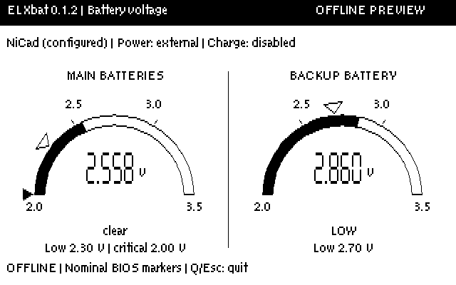

# ELXbat 0.1.2

Two large half-circle battery-voltage gauges, dark ink on a light background.

## How to use

```sh
chmod 755 elxbat
./elxbat
./elxbat --text
./elxbat --text --watch --interval 5
```

Run graphics from the local HP text console; use `--text` over serial. Requires
an HP firmware-aware ELKS kernel and readable `/dev/kmem` (normally root).

| Key | Action |
| --- | --- |
|  | Reread the firmware cache |
|  or  | Exit graphics |
|  +  | Stop text watch or exit through cleanup |



*Actual renderer using an offline fixture. The backup LOW flag above its marker
illustrates firmware hysteresis, not a discrepancy in the gauge.*

Outlined triangles mark nominal low thresholds: main 2.20 V alkaline / 2.30 V
NiCad; backup 2.70 V on BIOS 2.14. The solid triangle is nominal main critical
2.00 V. Unknown ROM versions omit the backup marker. Cached LOW / VERY LOW /
clear flags are shown independently. Values are volts, not charge percentages.

The program never changes battery policy or thresholds. Global LCD inversion
remains controlled by  + ; use the normal LCD polarity
for the default light appearance. The 0.1.2 release awaits physical HP testing.

[Threshold evidence](../../tools/elx-utils/THRESHOLDS.md) · [Full notes](../../tools/elx-utils/README.md) · [Suite](../../README.md)
