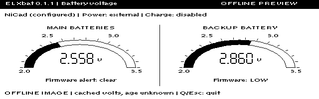

# ELXcap 0.1

Pixel-preserving monochrome screenshots for ELKS: BMP by default, PBM optional.
Inspired by GEMCAP's workflow; independent implementation.

## How to use

From an existing serial shell while the desired application is on the HP:

```sh
chmod 755 elxcap
mkdir /root/shots
./elxcap /root/shots/SCREEN.BMP
./elxcap -f pbm /root/shots/SCREEN.PBM
```

Requires firmware-aware ELKS and readable `/dev/kmem`. It captures the HP
screen, not the serial terminal, and never opens another serial port.
Existing files and symlinks are refused. Omit the filename for numbered captures.

A delayed capture works from the palmtop without a new kernel:

```sh
./elxcap -q -d 10 /root/shots/BATTERY.BMP >/tmp/elxcap.log 2>&1 &
elxbat
```

Keep ELXbat open until the delay completes. Both BMP and PBM preserve the same
640×200 one-bit pixels. Use `-i` to invert output pixels only.



*Lossless viewing conversion of an ELXcap BMP captured from an offline ELXbat
framebuffer fixture. Not a screenshot captured on physical hardware.*

## Repeated captures and optional hotkey

```sh
./elxcap --watch /root/shots >/tmp/elxcap.log 2>&1 &
```

The log reports a PID. From serial, `kill -10 PID` requests a capture;
`kill PID` stops the listener. Replace PID with the reported number.

The GEMCAP-style  shortcut requires the
**optional kernel integration**. It does not work on an unchanged 3.8 beta1 kernel:

```sh
./elxcap --hotkey /root/shots >/tmp/elxcap.log 2>&1 &
```

[Kernel integration and build instructions](../../tools/elx-cap/README.md#gemcap-style-altperiod-optional-kernel-integration)
are included as source, build-checked but not installed or physically validated.
No kernel binary is installed by the release.

CGA mode 6 is copied directly. Modes 2/3 are reconstructed as the full logical
80×25 text page; cursor, blink timing, LCD zoom/pan and hardware annunciators
are not reproduced. Global  inversion is not
captured; choose `-i` when wanted. Mode 7 is unsupported in 0.1.

[Full capture coverage and limitations](../../tools/elx-cap/README.md) · [Suite](../../README.md)
