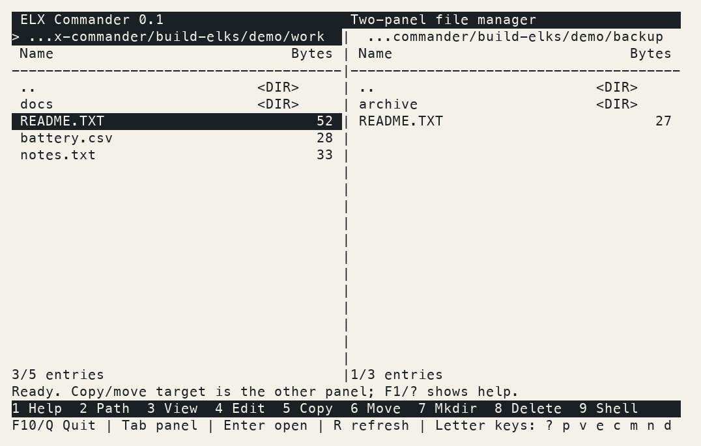

> **Legacy suite snapshot.** Maintained development has moved to
> [cmdr](https://github.com/l00nix/cmdr). The standalone executable is `cmdr`.
> Commands and versions below document the original suite release.

# ELX Commander 0.1

A two-panel, 80×25 text file manager for ELKS. Local console or serial; no Nano-X.

## How to use

```sh
chmod 755 elxcmd
./elxcmd /root /tmp
```

Zero paths opens the current directory in both panels; one path opens it in
both. Two paths set the left and right panels independently.



*Actual native program running in an emulator with sample directories; terminal
output rendered as an image. Physical HP keyboard/filesystem checks are pending.*

| Key | Action | Alternative |
| --- | --- | --- |
|  | Switch panel | |
|  /  | Select item | |
|  /  /  /  | Navigate list | |
|  | Open folder / view file | |
|  /  | Parent directory | |
|  | Help |  |
|  | Change panel path |  |
|  | View text |  |
|  | Edit with `vi` |  |
|  | Copy file |  |
|  | Move file |  |
|  | Make directory |  |
|  | Delete file/link/empty directory |  |
|  | Shell in active directory |  |
|  | Quit |  |
|  | Refresh panels | |

Lowercase alternatives work. Prompts use  to accept,
 to cancel, and  to edit. Only 
confirms a file operation. The viewer uses  /  /
 for next page,  for start, and  /
 to return. ELKS function-key sequences also work as
 **then** a digit (1–9, 0 for F10).

Copy/move handles one regular file; existing targets are refused. Move copies
then removes the source, so it needs free space. Delete is non-recursive and
requires confirmation. No multiselect, recursive copying or archive browsing
is included. Panels show at most 128 entries; incomplete listings are labelled.

Try disposable files first. [Full file-operation semantics and build notes](../../tools/elx-commander/README.md) · [Suite](../../README.md)
