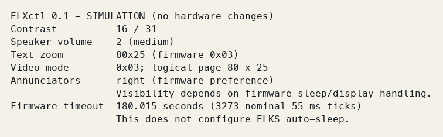

# ELXctl 0.1

A command-line control utility for firmware-aware ELKS on the HP 200LX.

## How to use

```sh
chmod 755 elxctl
./elxctl status
./elxctl contrast 16
./elxctl volume 2
./elxctl zoom 40x16
./elxctl zoom 80x25
./elxctl annunciators right
./elxctl firmware-timeout 180
```

Omit the value to query a setting. Each change is read back; no interactive
toggles or special key combinations are needed. Requires readable `/dev/kmem`
and supported HP firmware. Settings apply immediately to the current session.

| Setting | Values |
| --- | --- |
| Contrast | 0–31 |
| Volume | 0 off / 1 soft / 2 medium / 3 loud |
| Text zoom | 80x25 / 64x18 / 40x25 / 40x16 |
| Annunciators | left / right / off |
| Firmware timeout | off, or 0–3604 nominal seconds |

```sh
./elxctl --dry-run contrast 18
./elxctl --simulate
```

`--dry-run` reads the hardware and displays the planned call without applying
it. `--simulate` uses a labelled software model with no HP hardware access.



*Terminal rendering of actual simulation output, not an HP screenshot.*

Firmware timeout is **not ELKS auto-sleep**. Mode 7 supports only 80x25 and
40x16 zoom. Extreme contrast may be hard to read; the HP  +
 /  contrast controls remain available.

No charging, serial-power, LCD-power or clock controls are included. Physical
HP validation is pending. [Full notes](../../tools/elx-ctl/README.md) · [Suite](../../README.md)
