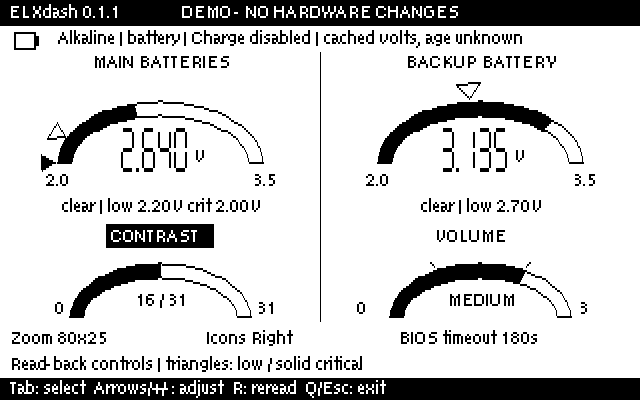

# ELXdash 0.2.0-test4

Battery monitoring and interactive settings on one 640×200 screen.
Native firmware-aware ELKS; no Nano-X or kernel patch required.

## How to use

Copy `elxdash` from the ELKS bundle and start from the local HP text console:

```sh
chmod 755 elxdash
./elxdash
```

To explore the same interface with synthetic values and no HP setting changes:

```sh
./elxdash --demo
```

| Key | Action |
| --- | --- |
|  /  /  | Select a control |
|  /  or  /  | Adjust or cycle the selected setting |
|  | Reread firmware settings and battery cache |
|  /  | Exit and apply queued text zoom |



*Actual shared renderer output in demo mode. Not a real-hardware screenshot.*

## What can change

| Control | Behaviour |
| --- | --- |
| Contrast | 0–31; gauge updates after read-back |
| Speaker volume | Off / Soft / Medium / Loud; four gauge levels |
| Text zoom | 80x25 / 64x18 / 40x25 / 40x16; queued until exit |
| Icons | BIOS annunciator preference: Left / Right / Off |
| BIOS timeout | Off to 3604 nominal seconds, 30-second adjustment steps |

Contrast, volume, icon preference and timeout changes take effect immediately
and remain set on exit. A star marks queued zoom; mode 7 offers only 80x25 and
40x16. Graphics do not zoom. BIOS timeout is **not ELKS auto-sleep policy**.

The top gauges are read-only battery voltages with outlined low-warning and
solid critical markers. Actual firmware flags remain separate. See
[battery threshold details](../../tools/elx-utils/THRESHOLDS.md). Cache age is
unknown; refreshing does not force an ADC measurement. Failed reads visibly
mark values stale and disable edits until a successful read.

ELXdash requires readable `/dev/kmem` (normally root) and graphics-console ownership. Serial sessions are rejected. Exit restores text mode, terminal input and zoom, and clears the text screen.

Earlier HP tests confirmed menu navigation, steady display and the default Start lock.
The current rebuild has its own [testing record](../TESTING.md). [Full build and implementation notes](../../tools/elx-dash/README.md) · [Suite](../../README.md)

## Automatic power indicator

The graphical display checks the firmware power-status byte once per second,
independently of the five-second default gauge refresh. The plug with a short
cable means external power; a battery outline means battery power. A lightning
bolt appears only when the firmware reports active charging, including fast
charging. Enabled-but-inactive charging does not show a bolt. The battery
outline is a power-source symbol, not a remaining-charge estimate.

A read failure replaces the symbol with `?` and labels the power status unknown.
The indicator recovers after a successful read. Power changes redraw only the
status strip, with no full-screen flash. Reads do not change any power or charging
settings. Firmware-cache update latency is unknown until hardware plug/unplug
testing; a one-second poll does not guarantee one-second physical detection.

## Experimental Battery menu

Press B to open or close the menu. Up/Down/Tab select one of five rows; Left/Right
or -/+ edit limits. Enter chooses Start or Stop; Esc closes the menu. Unchanged
polling does not repaint the menu. The three limits are stop voltage, maximum
time and voltage-stall time. Limits are test bounds, not a full-charge profile.

Normal startup leaves Start locked. Installing or opening the dashboard never
enables charging. An attended NiCd experiment requires `elxdash --charge-test`,
then Enter on Start and an explicit Y confirmation that two NiCd AA cells are
installed. N/Esc cancels. Never enable this with alkaline, NiMH or lithium cells.
The BIOS cannot identify the actual battery chemistry.

The experimental supervisor checks fresh readings, external power, firmware
faults and time/voltage/stall limits. It has no automatic restart or trickle
stage. It continues after Q exits the dashboard; reopen B and choose Stop test
to request shutdown. Status is stored under `/var/run/elxchg`, with the final
reason in `/var/run/elxchg-last`. Stale sessions block another start. Do not
remove the lock to bypass an uncertain session. If status becomes stale or
shutdown fails, disconnect external power. Userspace supervision cannot guarantee
shutdown after a forced kill, kernel hang or suspension.

No physical charging acceptance is claimed for this ELKS supervisor. DOS
LXdash/ABC tests do not validate the ELKS charging implementation. Ordinary menu
and display testing should run without `--charge-test`.
