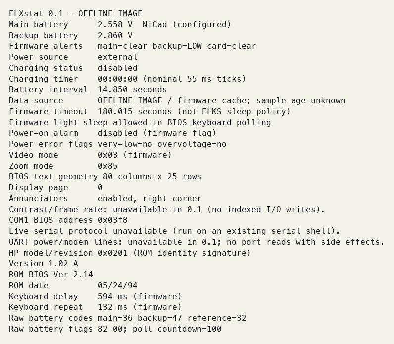

# ELXstat 0.1

Read-only battery, power, display, serial and firmware status for ELKS.

## How to use

Copy `elxstat` from the ELKS release bundle, then run on the HP:

```sh
chmod 755 elxstat
./elxstat
./elxstat -v
./elxstat battery
./elxstat power
./elxstat display
./elxstat serial
./elxstat system
```

No interactive keys are required. `-v` shows every supported section; pipe to
`more` if it exceeds the screen. `--help` lists options. Normally run as root
for read access to `/dev/kmem`; an HP firmware-aware kernel is required.



*Terminal rendering of actual offline-fixture output; not a hardware screenshot.*

Voltage readings and flags come from the firmware cache; sample age is unknown.
Firmware timeout is not ELKS sleep policy. Contrast/frame-rate and UART power
queries are intentionally unavailable in this version. No settings are changed.
The original 0.1 was observed running on the user's HP; that does not validate
all fields or the complete power/sleep path.

[Full implementation and build notes](../../tools/elx-utils/README.md) · [Suite](../../README.md)
