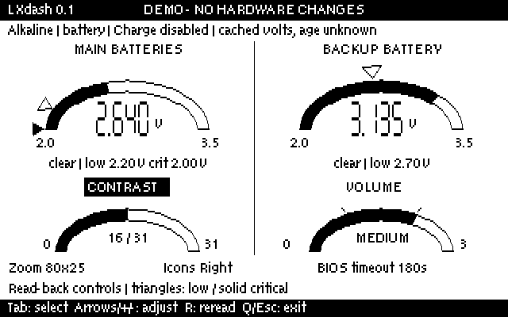

# LXdash 0.1

Battery monitoring and interactive settings on one 640×200 screen.
Real-mode 8086 DOS EXE; no extender or System Manager EXM required.

## How to use

Copy `LXDASH.EXE` from the DOS bundle and start from the local HP text console:

```bat
LXDASH.EXE
```

To explore the same interface with synthetic values and no HP setting changes:

```bat
LXDASH.EXE --demo
```

| Key | Action |
| --- | --- |
|  /  /  | Select a control |
|  /  or  /  | Adjust or cycle the selected setting |
|  | Reread firmware settings and battery cache |
|  /  | Exit and apply queued text zoom |



*Actual compiled DOS executable framebuffer with mocked services in demo mode. Not a real-hardware screenshot.*

## What can change

| Control | Behaviour |
| --- | --- |
| Contrast | 0–31; gauge updates after read-back |
| Speaker volume | Off / Soft / Medium / Loud; four gauge levels |
| Text zoom | 80x25 / 64x18 / 40x25 / 40x16; queued until exit |
| Icons | BIOS annunciator preference: Left / Right / Off |
| BIOS timeout | Off to 3604 nominal seconds, 30-second adjustment steps |

Contrast, volume, icon preference and timeout changes take effect immediately
and remain set on exit. A star marks queued zoom; mode 7 offers only 80x25 and
40x16. Graphics do not zoom. BIOS timeout is **not ELKS auto-sleep policy**.

The top gauges are read-only battery voltages with outlined low-warning and
solid critical markers. Actual firmware flags remain separate. See
[battery threshold details](../../tools/elx-utils/THRESHOLDS.md). Cache age is
unknown; refreshing does not force an ADC measurement. Failed reads visibly
mark values stale and disable edits until a successful read.

On exit LXdash restores the saved text page, cursor position/shape and zoom. Only text page zero is supported. This is a foreground DOS program, not a TSR; display-hooking TSR compatibility is untested.

Physical HP testing is pending. [Full build and implementation notes](../../tools/elx-dash/README.md) · [Suite](../../README.md)
